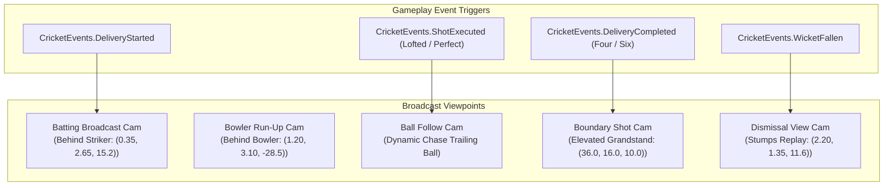

# Cricket Legends — Phase 2: 3D Stadium & Presentation Specification

## 1. Ground Geometry & Coordinate Conventions

Cricket Legends adopts standard metric units (**1 Unity Unit = 1.0 Meter**) and official MCC (Marylebone Cricket Club) ground dimensions.

```text
                                [North - Bowling End]
                                   Z = -25.0m : Bowler Run-Up Start
                                   Z = -10.06m : Bowler Wickets (3 Stumps, 2 Bails)
                                   Z = -8.84m : Bowler Popping Crease
                                          |
                                          | 20.12m (22 Yards Pitch Strip)
                                          |
                                   Z = 0.00m : Pitch Center (0, 0, 0)
                                          |
                                   Z = +8.84m : Striker Popping Crease
                                   Z = +10.06m : Striker Wickets (3 Stumps, 2 Bails)
                                   Z = +15.80m : Wicketkeeper Position
                                [South - Batting End]
```

### 1.1 Ground Dimensions Table
| Ground Feature | Dimension (Meters) | Description & Standard |
|---|---|---|
| **Pitch Length (Wickets)** | `20.12 m` (22 yards) | Distance between bowling creases / stumps at both ends. |
| **Pitch Strip Length** | `22.56 m` | Full prepared turf including 1.22m runoff behind bowling creases. |
| **Pitch Strip Width** | `3.05 m` (10 feet) | Central clay strip width. |
| **Popping Crease Offset** | `1.22 m` (4 feet) | Distance in front of bowling crease (`Z = +8.84m` & `-8.84m`). |
| **Bowling Crease Width** | `2.64 m` (8 ft 8 in) | Centered line passing through the stumps. |
| **Return Creases** | `X = ±1.32 m` | Perpendicular lines extending at least 2.44m behind popping crease. |
| **Stumps Height** | `0.711 m` (28 inches) | 3 vertical wooden stumps per end. |
| **Wicket Width** | `0.2286 m` (9 inches) | Total width across Off, Middle, and Leg stumps. |
| **Bails (Pair)** | `0.111 m` (4 3/8 in) | Resting atop the stumps with physics dislodgement impulses. |
| **30-Yard Circle** | Radius = `27.43 m` | Fielding restriction circle with 20 white marker discs. |
| **Boundary Oval** | `66.0 m` x `72.0 m` | Major Z radius 72m, minor X radius 66m; braided rope perimeter. |
| **Stadium Grandstands** | `72.0 m` to `96.0 m` | Tiered spectator bowl with 4 concrete seating terraces. |
| **Floodlight Towers (4)** | Distance `95.0 m`, Height `44.0 m` | 4 lattice mast towers with focused LED spotlights. |

---

## 2. Visual Presentation & URP Lighting

### 2.1 Lighting Presets
- **Daytime Lighting (`DaySunny`)**:
  - Primary Sun directional light: Warm daylight (`#FFF8E7`, intensity `1.35`), elevation angle 50°.
  - Soft ambient fill (`#99ADC0`).
  - Single shadow-casting light (optimized for mobile performance).
- **Night-time Lighting (`NightFloodlights`)**:
  - Cool moonlight directional light (`#8CA6D9`, intensity `0.20`).
  - Deep atmospheric ambient sky (`#141F33`).
  - 4 High-powered LED spotlight arrays (`#F2FAFF`, intensity `3800` lumens) aimed downward toward pitch and outfield.
  - Floodlight shadows are disabled to maintain 60 FPS on mobile.

### 2.2 Material Palette (PBR & URP Lit)
- **Grass Outfield**: Two-tone alternating concentric lawn mower bands (`Mat_Grass_Light` & `Mat_Grass_Dark`) providing authentic visual texture without redundant multi-texture lookups.
- **Pitch Surface**: Straw/clay compacted soil (`Mat_Pitch_Turf`) contrasting with lush outfield.
- **Creases**: Pure white painted enamel lines (`Mat_Crease_Line`).
- **Woodwork**: Varnished ash wood (`Mat_Wood_Varnish`) for stumps, bails, and bats.
- **Stadium Stands**: Concrete tiers (`Mat_Concrete_Stands`) with color-blocked crowd spectator bands (`Mat_Crowd_Tier`).

---

## 3. Broadcast Camera Director System

The [`CameraDirector`](file:///c:/Users/Shiven/Documents/Games/Cricket%20game/Assets/_Game/Scripts/Cameras/CameraDirector.cs) coordinates 5 dynamic broadcast viewpoints:



### Camera Presets Specification:
1. **`BattingBroadcast`**: Standard TV broadcast angle behind the striker looking up-pitch toward bowler. FOV 48°.
2. **`BowlerRunUp`**: Dynamic trailing perspective behind bowler, capturing the run-up cadence and release. FOV 52°.
3. **`BallFollow`**: Dynamic tracking camera following the ball trajectory in mid-air. Clamped above ground.
4. **`BoundaryShot`**: Sweeping grandstand angle capturing outfield pursuits and boundary four/six celebrations. FOV 55°.
5. **`DismissalView`**: Dramatic low-angle close-up replay focusing on dislodged stumps and tumbling bails. FOV 38°.

All transitions utilize `Vector3.SmoothDamp` and `Quaternion.Slerp` with ground collision safety clamping (`pos.y >= 0.5m`).

---

## 4. Humanoid-Ready Placeholder Player Rigs

The [`PlaceholderPlayerRig`](file:///c:/Users/Shiven/Documents/Games/Cricket%20game/Assets/_Game/Scripts/Players/PlaceholderPlayerRig.cs) builds athletic 1.82m tall character silhouettes using hierarchical bones:
- `Hips` (Root pelvis at `Y = 0.95m`)
  - `Spine` (Torso at `Y = 1.27m`)
    - `Head` (Face & helmet peak at `Y = 1.65m`)
    - `LeftArm` & `RightArm` (Articulated shoulder joints)
      - `BatMountPoint` (Rigged willow bat blade & handle)
  - `LeftLeg` & `RightLeg` (Thighs and batting pads)

This modular bone hierarchy ensures **seamless drop-in replacement with rigged, skinned humanoid 3D models** in future phases.

---

## 5. Performance Optimizations for Mobile & PC
- **Crowd Representation**: Replaced thousands of heavy skeletal animated human meshes with lightweight tiered crowd ribbons in the grandstands.
- **Shadow Optimization**: Shadow cascades set to 1 and distance 45m on mobile; 4 cascades on PC. Dynamic shadows cast exclusively from primary directional sunlight.
- **Zero Garbage Collection**: Smooth damp velocities, camera vectors, and wicket coordinates cached to eliminate per-frame heap allocations.
