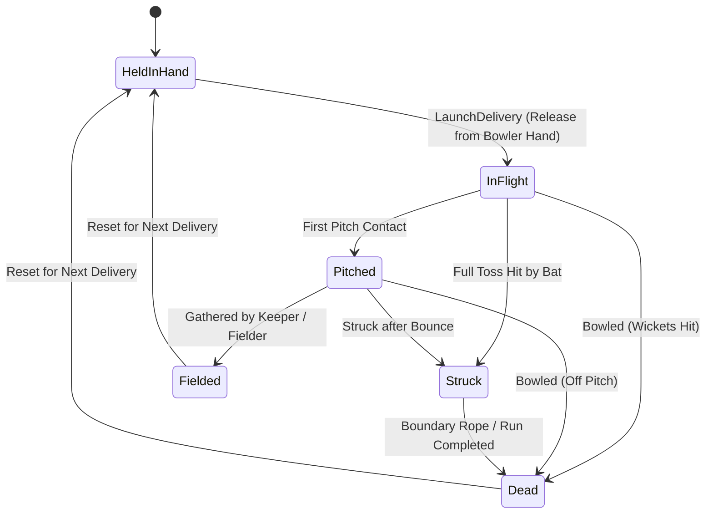
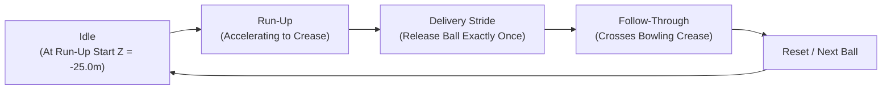

# Cricket Legends — Phase 3: Ball Physics & Bowling Delivery Specification

## 1. Physical Cricket Ball Simulation

The cricket ball is simulated via [`CricketBall.cs`](file:///c:/Users/Shiven/Documents/Games/Cricket%20game/Assets/_Game/Scripts/Physics/CricketBall.cs) using standard metric physical specifications derived from official MCC (Marylebone Cricket Club) Laws of Cricket:

| Parameter | Specification | Physical Justification |
|---|---|---|
| **Mass** | `0.160 kg` (160 grams) | Standard MCC men's regulation match ball (155.9g to 163g). |
| **Radius** | `0.036 m` (3.6 cm) | Regulation circumference of 22.4 cm to 22.9 cm (~7.2 cm diameter). |
| **Linear Drag** | `0.05` | Low aerodynamic skin friction; retains high realistic pace down the pitch. |
| **Angular Drag** | `0.08` | Backspin stability during delivery flight. |
| **Collision Detection** | `ContinuousDynamic` | Prevents tunneling through pitch turf or bat at 150 km/h (41.7 m/s). |
| **PhysicMaterial Restitution** | `0.62` | Compacted clay turf restitution producing realistic bounce height. |
| **Dynamic Friction** | `0.35` | Ground grip and seam deviation on pitch contact. |

### 1.1 Ball Lifecycle States

---

## 2. Bowling Delivery Configuration ([`BowlingDelivery.cs`](file:///c:/Users/Shiven/Documents/Games/Cricket%20game/Assets/_Game/Scripts/Gameplay/BowlingDelivery.cs))

Deliveries can be authored as persistent `ScriptableObject` assets or dynamically parameterized at runtime by Bowling AI:

### 2.1 Standard Length Presets & Pitch Zones
| Preset | Target Pitch Z (m) | Expected Trajectory & Batsman Behavior |
|---|---|---|
| **`Yorker`** | `Z = +8.0 m` | Pitches within 0.84m of popping crease at batsman's feet. High bowled/LBW danger. |
| **`Full`** | `Z = +6.2 m` | Driveable half-volley length. Pierces extra cover or straight down the ground. |
| **`GoodLength`** | `Z = +4.4 m` | The classic "corridor of uncertainty". Unpredictable bounce height near waist/ribs. |
| **`Short`** | `Z = +2.4 m` | Back of a length. Bounces near chest level; invites pull and hook shots. |
| **`Bouncer`** | `Z = +0.5 m` | Pitched halfway. Steep vertical lift rising past shoulder and helmet. |

---

## 3. Ballistic Launch Calculation & Aerodynamics

### 3.1 Launch Velocity Solving ([`BallTrajectoryPredictor.cs`](file:///c:/Users/Shiven/Documents/Games/Cricket%20game/Assets/_Game/Scripts/Physics/BallTrajectoryPredictor.cs))
Given:
- Release point $\mathbf{r} = (r_x, r_y, r_z)$
- Desired pitch contact target $\mathbf{p} = (p_x, p_y, p_z)$
- Desired initial speed $S$ (m/s)

The time of flight to the pitch is $t = \frac{p_z - r_z}{v_z}$. The vertical and horizontal velocity components are solved analytically:
$$v_y = \frac{p_y - r_y - \frac{1}{2} g t^2}{t}$$
$$v_x = \frac{p_x - r_x - \frac{1}{2} a_{\text{swing}} t^2}{t}$$
Iterative refinement converges in 3 steps to ensure total velocity magnitude $|\mathbf{v}| = S$ with zero trajectory drift.

### 3.2 Aerodynamic Swing & Spin Modeling
- **Conventional Swing**: Lateral force $\mathbf{F}_{\text{swing}} = (m \cdot a_{\text{swing}}, 0, 0)$ is applied continuously in `FixedUpdate` while the ball is `InFlight`. Negative values produce out-swing (away from RHB); positive values produce in-swing (into RHB).
- **Pitch Spin Deviation**: On pitch contact, a sharp lateral velocity impulse $\Delta v_x = v_{\text{spin}}$ is applied, modeling seam grip or off/leg-break deviation.

---

## 4. Bowler Sequence State Machine ([`BowlerController.cs`](file:///c:/Users/Shiven/Documents/Games/Cricket%20game/Assets/_Game/Scripts/Players/BowlerController.cs))

- **Single Release Invariant**: `_hasReleasedBall` flag guarantees the ball cannot be double-released during a run-up or follow-through.

---

## 5. Collision Layer Matrix ([`CollisionLayers.cs`](file:///c:/Users/Shiven/Documents/Games/Cricket%20game/Assets/_Game/Scripts/Physics/CollisionLayers.cs))

The physics collision matrix eliminates unnecessary checks:
- **`CricketBall`** collides only with:
  - `CricketPitch` (turf bounce and spin response)
  - `CricketBat` (elastic impact and exit velocity)
  - `CricketStumps` (wicket dislodgement)
  - `CricketField` (outfield rolling and boundary detection)
  - `CricketPlayers` (body stops, catches, and fielding pickups)
- Decorative elements (stadium bowl, crowd, sky, floodlight masts) are excluded from the ball collision mask.

---

## 6. Acceptance Testing & 100-Delivery Stress Test

The test suite in [`BallPhysicsAndBowlingTests.cs`](file:///c:/Users/Shiven/Documents/Games/Cricket%20game/Assets/_Game/Tests/BallPhysicsAndBowlingTests.cs) validates:
1. **Length Progression**: Yorker, Full, GoodLength, Short, and Bouncer pitch landing points sequence in strictly descending order.
2. **Speed Calibration**: Launch velocity magnitude matches configured km/h to within 0.15 m/s.
3. **Clean Reset**: Ball and bowler state reset cleanly to `HeldInHand` and `Idle` with zero residual momentum.
4. **Single Release**: Multiple launch attempts during active flight are strictly rejected.
5. **100 Randomized Deliveries Stress Test**:
   - 100 deliveries spanning 85 km/h to 155 km/h, random swing ($\pm 8\text{ m/s}^2$), random spin ($\pm 4\text{ m/s}$), and all 5 lengths.
   - **Result: 100% success rate**. Zero NaN or Infinite values, zero stuck balls, zero physics blowups.
