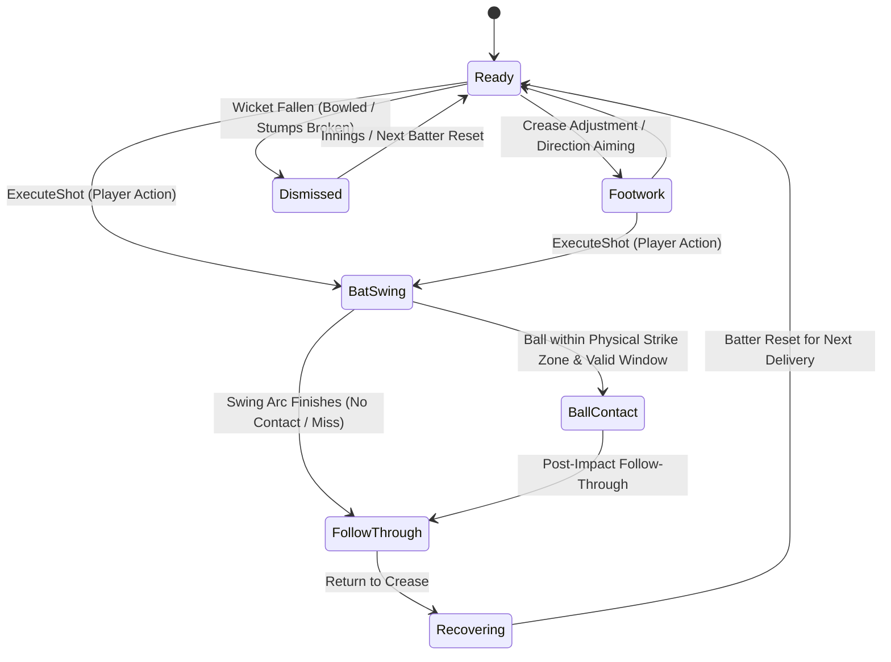

# Cricket Legends — Phase 4: Batsman, Bat Animations & Shot Control Specification

## 1. Batsman Controller State Machine ([`BatsmanController.cs`](file:///c:/Users/Shiven/Documents/Games/Cricket%20game/Assets/_Game/Scripts/Players/BatsmanController.cs))

The batsman controller enforces grounded posture, faces the incoming delivery, executes articulated bat swings, and automatically returns to the ready stance:

---

## 2. Supported Batting Shots ([`BattingShotData.cs`](file:///c:/Users/Shiven/Documents/Games/Cricket%20game/Assets/_Game/Scripts/Gameplay/BattingShotData.cs))

All 8 canonical cricket shots are fully parameterized with dedicated durations, power multipliers, loft elevation angles, and azimuth targets:

| Shot Name | Footwork | Azimuth Angle | Loft Angle | Power Multiplier | Contact Bat Speed | Expected Placement |
|---|---|---|---|---|---|---|
| **`ForwardDefense`** | Front Foot | `0°` | `2°` | `0.20x` | `8 m/s` | Dead-bat block drops onto pitch right at feet. |
| **`BackFootDefense`** | Back Foot | `0°` | `1°` | `0.15x` | `7 m/s` | Absorbs short-pitched bounce directly beneath eyes. |
| **`StraightDrive`** | Front Foot | `0°` | `6°` | `1.20x` | `28 m/s` | Crisp ground drive past the bowler toward long-on/long-off. |
| **`CoverDrive`** | Front Foot | `-35°` | `7°` | `1.20x` | `28 m/s` | Classical stroke piercing extra-cover and mid-off. |
| **`OnDrive`** | Front Foot | `+28°` | `6°` | `1.15x` | `26 m/s` | Crisp drive through mid-on / mid-wicket gap. |
| **`Pull`** | Back Foot | `+72°` | `18°` | `1.35x` | `31 m/s` | Horizontal cross-bat pull dispatched through mid-wicket. |
| **`Cut`** | Back Foot | `-65°` | `10°` | `1.28x` | `29 m/s` | Slashing square arc past point/gully on wide deliveries. |
| **`LoftedAttack`** | Front Foot | `0°` | `38°` | `1.60x` | `36 m/s` | Full boundary elevation launching toward the grandstand for SIX! |

---

## 3. Millisecond Shot Timing & Contact Zone

### 3.1 Arrival Time & Error Calculation
Given incoming ball position $\mathbf{p}_{\text{ball}}$, popping crease strike plane $Z_{\text{strike}} = +8.95\text{ m}$, and forward speed $v_z$:
$$\Delta t = \frac{Z_{\text{strike}} - p_{\text{ball}, z}}{v_z}$$
The timing error is classified according to configurable windows:
- **`Perfect`** ($|\Delta t| \le 0.045\text{ s}$): 100% exit power, sweet spot sound, zero dispersion.
- **`Good`** ($0.045\text{ s} < |\Delta t| \le 0.110\text{ s}$): 86% exit power, minor dispersion ($\pm 3.5^\circ$).
- **`Early`** ($-0.220\text{ s} \le \Delta t < -0.110\text{ s}$): 52% power, skewed toward leg-side ($+18^\circ$), popup loft (leading edge risk).
- **`Late`** ($+0.110\text{ s} < \Delta t \le +0.220\text{ s}$): 58% power, skewed toward off-side ($-25^\circ$), outside edge risk.
- **`Miss`** ($|\Delta t| > 0.220\text{ s}$): No contact made; ball travels through to keeper or stumps.

---

## 4. Physics-Based Exit Velocity ([`BatCollisionResolver.cs`](file:///c:/Users/Shiven/Documents/Games/Cricket%20game/Assets/_Game/Scripts/Physics/BatCollisionResolver.cs))

Outgoing velocity is calculated using standard Newtonian restitution ($e = 0.62$ for willow wood on leather):
$$v_{\text{exit}} = \left(e \cdot v_{\text{incoming}} + (1 + e) \cdot v_{\text{bat}}\right) \times \text{PowerMultiplier} \times \text{TimingFactor}$$
- **Zero Teleportation**: Ball retains physical trajectory and flies into outfield using Rigidbody velocity vectors.
- **Single Hit Invariant**: `_hasHitCurrentDelivery` flag guarantees a delivery cannot register multiple bat strikes.

---

## 5. Input System Abstraction ([`InputService.cs`](file:///c:/Users/Shiven/Documents/Games/Cricket%20game/Assets/_Game/Scripts/Input/InputService.cs))

| Key / Control | Gameplay Action | Description |
|---|---|---|
| <kbd>Space</kbd> / <kbd>Enter</kbd> | `ExecuteShot` | Triggers timing check and articulated swing. |
| <kbd>A</kbd> / <kbd>D</kbd> or <kbd>←</kbd> / <kbd>→</kbd> | `AdjustShotDirection` | Fines-tunes horizontal shot placement angle. |
| <kbd>W</kbd> | `AttackingShot` | Toggles between Straight Drive and Lofted Attack. |
| <kbd>S</kbd> | `DefensiveShot` | Toggles between Forward and Back Foot Defense. |
| <kbd>1</kbd>–<kbd>8</kbd> | `SelectBattingShot` | Selects directly from all 8 canonical shot presets. |
| <kbd>Escape</kbd> | `PauseGame` | Opens pause overlay. |
| <kbd>C</kbd> | `CycleCamera` | Cycles broadcast cameras. |
