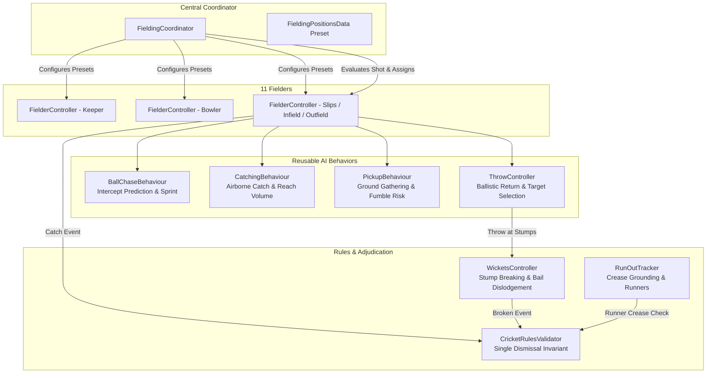

# Cricket Legends — Phase 5: Fielding & Dismissals Architecture Specification

## 1. Modular Fielding Architecture

Phase 5 introduces an intelligent, physics-driven fielding system that operates on the actual 3D simulated ball (`CricketBall`). Instead of monolithic AI routines duplicated across every player, the architecture decouples field placement, pursuit estimation, ground gathering, catching physics, and throwing dynamics across dedicated components:

---

## 2. Component Directory

| Component | Path | Responsibility |
|---|---|---|
| [`FielderController.cs`](file:///c:/Users/Shiven/Documents/Games/Cricket%20game/Assets/_Game/Scripts/AI/FielderController.cs) | `Assets/_Game/Scripts/AI/` | Per-fielder state machine (`Ready`, `Reacting`, `Chasing`, `Catching`, `PickingUp`, `Throwing`, `Returning`). Sprint kinematics (~7.5 m/s), reaction delays (0.2–0.35s), and orientation towards wickets. |
| [`FieldingCoordinator.cs`](file:///c:/Users/Shiven/Documents/Games/Cricket%20game/Assets/_Game/Scripts/AI/FieldingCoordinator.cs) | `Assets/_Game/Scripts/AI/` | Central manager registering 11 fielders, applying field presets (`Balanced`, `Attacking`, `Defensive`), evaluating struck ball trajectories on `CricketEvents.BallHit`, and resetting all fielders. |
| [`CatchingBehaviour.cs`](file:///c:/Users/Shiven/Documents/Games/Cricket%20game/Assets/_Game/Scripts/AI/CatchingBehaviour.cs) | `Assets/_Game/Scripts/AI/` | Static catch evaluation. Enforces strict airborne invariant (`BounceCount == 0`), reach volume ($r \le 1.85\text{m}$, height $0.20\text{m} \le y \le 2.45\text{m}$), minimum reaction time ($t \ge 0.15\text{s}$), and speed/distance difficulty weighting. |
| [`PickupBehaviour.cs`](file:///c:/Users/Shiven/Documents/Games/Cricket%20game/Assets/_Game/Scripts/AI/PickupBehaviour.cs) | `Assets/_Game/Scripts/AI/` | Ground ball interception ($r \le 1.6\text{m}$) for bounced balls (`BounceCount > 0`). Simulates fumble probability on fast ground balls (> 22 m/s). |
| [`BallChaseBehaviour.cs`](file:///c:/Users/Shiven/Documents/Games/Cricket%20game/Assets/_Game/Scripts/AI/BallChaseBehaviour.cs) | `Assets/_Game/Scripts/AI/` | Predicts ground intercept point with boundary clamping ($R \le 68\text{m}$), computing smooth acceleration/sprint movement vectors. |
| [`ThrowController.cs`](file:///c:/Users/Shiven/Documents/Games/Cricket%20game/Assets/_Game/Scripts/AI/ThrowController.cs) | `Assets/_Game/Scripts/AI/` | Analyzes runner positions and determines optimal throw destination (`StrikerEnd` vs `BowlerEnd`). Calculates ballistic launch vector with slight release inaccuracy. |
| [`RunOutTracker.cs`](file:///c:/Users/Shiven/Documents/Games/Cricket%20game/Assets/_Game/Scripts/Rules/RunOutTracker.cs) | `Assets/_Game/Scripts/Rules/` | Tracks runner coordinates along the pitch Z-axis. Evaluates whether a runner has crossed popping crease threshold ($Z \ge +8.84\text{m}$ at striker end, $Z \le -8.84\text{m}$ at bowler end). |
| [`CricketRulesValidator.cs`](file:///c:/Users/Shiven/Documents/Games/Cricket%20game/Assets/_Game/Scripts/Rules/CricketRulesValidator.cs) | `Assets/_Game/Scripts/Rules/` | Authoritative dismissal adjudicator (`Bowled`, `Caught`, `RunOut`, `Stumped`, `LBW`). Enforces single dismissal per delivery invariant. |

---

## 3. Fielding Presets & Positions ([`FieldingPositionsData.cs`](file:///c:/Users/Shiven/Documents/Games/Cricket%20game/Assets/_Game/Scripts/Presentation/FieldingPositionsData.cs))

All 11 players are positioned according to official international cricket fielding geometry:

1. **Balanced Preset (Standard Limited Overs)**:
   - Bowler (`(0.8, 0, -10.5)`), Wicketkeeper (`(0.0, 0, 16.0)`), First Slip (`(2.5, 0, 15.5)`)
   - Infield: Point (`(16.5, 0, 11.0)`), Cover (`(18.0, 0, 2.0)`), Mid-Off (`(10.0, 0, -6.5)`), Mid-On (`(-9.5, 0, -6.5)`), Mid-Wicket (`(-16.5, 0, 3.5)`), Square Leg (`(-18.0, 0, 12.0)`)
   - Outfield: Deep Fine Leg (`(-28.0, 0, 42.0)`), Long-On (`(-22.0, 0, -45.0)`)

2. **Attacking Preset (Red-Ball / Wicket-Hunting)**:
   - Stacked cordon: First Slip (`(2.4, 0, 15.2)`), Second Slip (`(3.8, 0, 14.8)`), Gully (`(8.5, 0, 12.0)`), Short Leg (`(-3.2, 0, 9.5)`), Cover, Mid-Off, Mid-On, Mid-Wicket, Deep Fine Leg.

3. **Defensive Preset (Death Overs / Boundary Saving)**:
   - Ring back to boundary rope: Deep Point, Deep Cover, Long-Off, Long-On, Deep Mid-Wicket, Deep Square Leg, Deep Fine Leg, Third Man, Cover Point.

---

## 4. Dismissal Adjudication Rules (MCC Laws)

### 4.1 Single Dismissal Invariant
Under the Laws of Cricket, only **one dismissal** can occur per delivery.
- If a batter is Bowled, subsequent breaking of stumps during a scramble cannot award a Run Out.
- If a catch is taken, any throw breaking the stumps is dead ball.
- `CricketRulesValidator` enforces this via an atomic `_isDismissalRecorded` flag that resets exclusively upon `CricketEvents.DeliveryStarted`.

### 4.2 Caught Dismissal (Law 33)
- Ball **must not have touched the ground** prior to catch completion (`ball.BounceCount == 0`).
- Ball must be in active flight following a bat strike (`BallState.Struck` or `BallState.InFlight`).
- Fielder reach sphere radius is $\le 1.85\text{m}$; vertical reach between $0.20\text{m}$ (ankle scoop) and $2.45\text{m}$ (overhead jump).
- Reaction delay $\ge 0.15\text{s}$ required (reflex limit).

### 4.3 Bowled Dismissal (Law 32)
- Striker-end wicket broken (`strikerWickets.End == StrikerEnd && strikerWickets.IsBroken`).
- Ball was delivered and in active play (`ball.State != HeldInHand && ball.State != Dead`).
- Credited to the bowler.

### 4.4 Run Out Dismissal (Law 38)
- Wickets put down at either end while a runner is out of their ground during a run.
- Striker end popping crease threshold: $Z \ge +8.84\text{m}$.
- Bowler end popping crease threshold: $Z \le -8.84\text{m}$.
- If runner has crossed the popping crease threshold before bails are dislodged, the runner is **Not Out**.
- Under MCC Law 38.2, **the bowler is NOT credited with the wicket** in bowling figures.

### 4.5 Stumped Dismissal (Law 39)
- Batter is outside their ground ($Z_{\text{striker}} < 8.84\text{m}$).
- Batter is **not attempting a run** (`isRunning == false`).
- Wicket put down by the wicketkeeper without intervention from any other fielder.
- Credited to both wicketkeeper and bowler.
