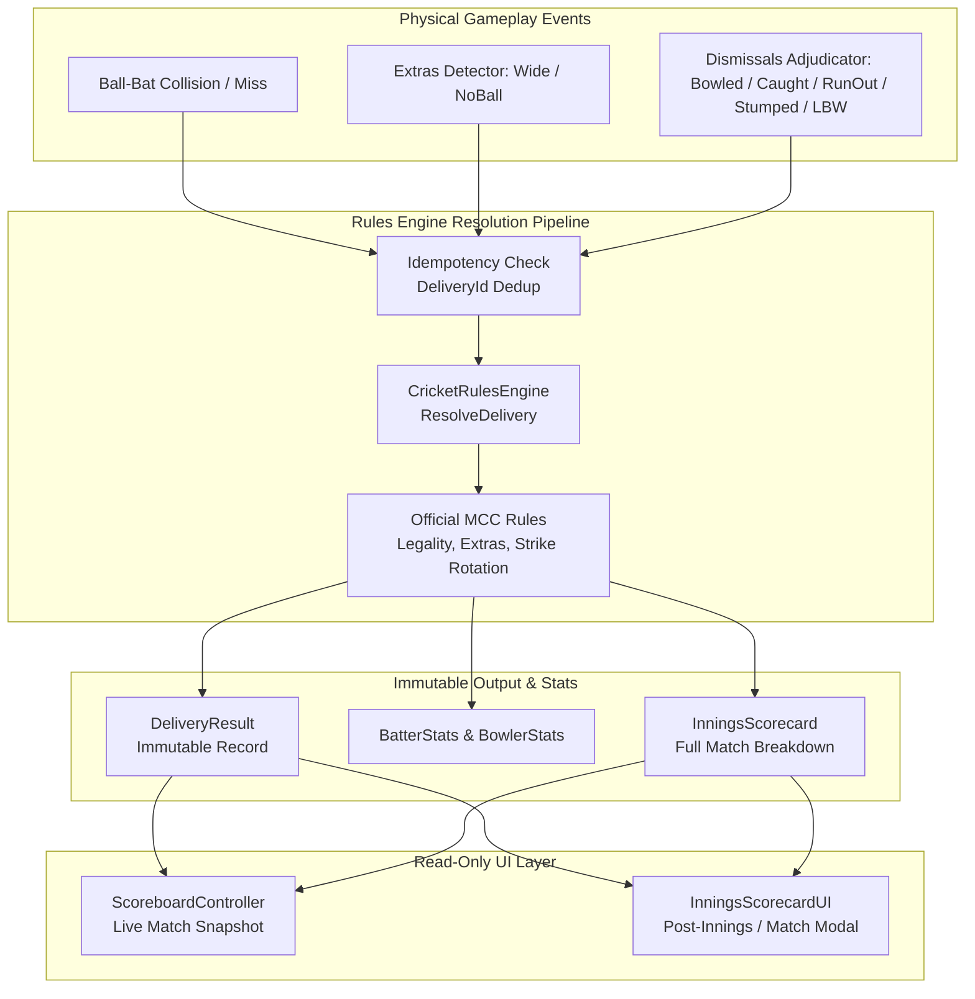

# Cricket Legends — Phase 6: Official Match Flow & Scoring Specification

## 1. Centralized Rules & Scoring Architecture

Phase 6 implements the authoritative, centralized cricket rules engine for **Cricket Legends**. The system strictly enforces the architectural requirement that **all score changes, strike rotations, and match progressions pass through the rules engine**. Presentation components (HUD, scoreboard, broadcast overlays) are strictly read-only and consume immutable snapshots.

---

## 2. Component Directory

| Component | Path | Responsibility |
|---|---|---|
| [`CricketRulesEngine.cs`](file:///c:/Users/Shiven/Documents/Games/Cricket%20game/Assets/_Game/Scripts/Rules/CricketRulesEngine.cs) | `Assets/_Game/Scripts/Rules/` | Central rules authority. Enforces single-resolution idempotency per `DeliveryId`, legal ball counts, over transitions, strike swaps, extras, maiden overs, target chasing, and winner/tie determination. |
| [`DeliveryResult.cs`](file:///c:/Users/Shiven/Documents/Games/Cricket%20game/Assets/_Game/Scripts/Rules/DeliveryResult.cs) | `Assets/_Game/Scripts/Rules/` | Contains `DeliveryOutcomeInput` and immutable `DeliveryResult` with complete delivery metadata, batter runs, extra runs, dismissal info, and strike rotation flag. |
| [`ExtraType.cs`](file:///c:/Users/Shiven/Documents/Games/Cricket%20game/Assets/_Game/Scripts/Rules/ExtraType.cs) | `Assets/_Game/Scripts/Rules/` | Official MCC extras categories: `None`, `Wide`, `NoBall`, `Bye`, `LegBye`, `Penalty`. |
| [`BatterStats.cs`](file:///c:/Users/Shiven/Documents/Games/Cricket%20game/Assets/_Game/Scripts/Rules/BatterStats.cs) | `Assets/_Game/Scripts/Rules/` | Tracks individual batter performance: Runs, balls faced (excluding wides), 4s, 6s, strike rate, and official dismissal line (`b Bowler`, `c Fielder b Bowler`, `run out`, `not out`). |
| [`BowlerStats.cs`](file:///c:/Users/Shiven/Documents/Games/Cricket%20game/Assets/_Game/Scripts/Rules/BatterStats.cs) | `Assets/_Game/Scripts/Rules/` | Tracks individual bowler figures: Overs, maidens, runs conceded (excluding byes/leg-byes), wickets (excluding run-outs), wides, no-balls, and economy rate. |
| [`InningsScorecard.cs`](file:///c:/Users/Shiven/Documents/Games/Cricket%20game/Assets/_Game/Scripts/Rules/InningsScorecard.cs) | `Assets/_Game/Scripts/Rules/` | Innings-level statistics and full ASCII report generation. |
| [`ScoreboardController.cs`](file:///c:/Users/Shiven/Documents/Games/Cricket%20game/Assets/_Game/Scripts/UI/ScoreboardController.cs) | `Assets/_Game/Scripts/UI/` | Read-only presenter binding to `CricketRulesEngine`. Generates `ScoreboardSnapshot` (Runs, Wickets, Overs, Striker, Non-Striker, Bowler, CRR, RRR, Target, Remaining runs/balls). |
| [`InningsScorecardUI.cs`](file:///c:/Users/Shiven/Documents/Games/Cricket%20game/Assets/_Game/Scripts/UI/InningsScorecardUI.cs) | `Assets/_Game/Scripts/UI/` | Detailed end-of-innings and end-of-match summary viewer. |
| [`MatchConfiguration.cs`](file:///c:/Users/Shiven/Documents/Games/Cricket%20game/Assets/_Game/Scripts/Gameplay/MatchConfiguration.cs) | `Assets/_Game/Scripts/Gameplay/` | ScriptableObject configuration supporting exhibition matches, 11-player squads, toss winners/decisions, target scores, and overs/wickets limits. |

---

## 3. Official MCC Cricket Rules Logic

### 3.1 Idempotency & Single Resolution
- Every physical delivery is stamped with a unique `DeliveryId`.
- The rules engine maintains a `HashSet<int> _resolvedDeliveryIds`.
- If an event re-submits a previously resolved delivery, the cached `DeliveryResult` is returned without re-incrementing runs, balls, or wickets.

### 3.2 Extras Accounting & Statistics
- **Wide**:
  - Awards 1 penalty run (+ any overthrows).
  - Does NOT consume a legal ball (`isLegalBall = false`).
  - Batter runs = 0; ball does NOT count as a ball faced for the batter.
  - Bowler is charged with the wide runs in their bowling figures.
- **No-Ball**:
  - Awards 1 penalty run.
  - Does NOT consume a legal ball (`isLegalBall = false`).
  - Batter CAN hit the ball for runs and boundaries (e.g., No-Ball + 4 = 5 runs to team; 4 runs credited to batter).
  - Bowler is charged with all runs conceded.
  - **MCC Law 21.18 Dismissal Protection**: Batter CANNOT be dismissed Bowled, Caught, Stumped, or LBW off a No-Ball. Only Run-Out is permissible.
- **Byes & Leg-Byes**:
  - Legal balls (`isLegalBall = true`).
  - Batter runs = 0. Strike rotates on odd completed runs.
  - **MCC Law 16.3**: Byes and leg-byes are **NOT charged against the bowler** in their bowling figures.

### 3.3 Strike Rotation Mechanics
1. **During an Over**:
   - Odd completed runs (1, 3) or odd byes/leg-byes swap the striker and non-striker.
   - Even completed runs (0, 2, 4, 6) do NOT rotate strike.
2. **At Over Completion (6th Legal Ball)**:
   - In international cricket (MCC Law 18.11), batters change ends at the end of each over.
   - If even runs (or 0) were scored on the 6th ball, the non-striker takes strike for the first delivery of the next over.
   - If an odd run was scored on the 6th ball, batters crossed during the run, and the subsequent change of ends returns the same batter to strike.
   - Bowler rotates to the next bowler in the squad.

### 3.4 Match Termination & Tie Adjudication
- **1st Innings Completion**:
  - Triggered when `TotalWickets >= MaxWickets` (All Out) or `LegalBalls >= TotalOvers * 6`.
  - Sets Target Score = `TotalRuns + 1`.
- **2nd Innings Target Chase**:
  - **Target Achieved**: If `TotalRuns >= TargetScore`, match immediately terminates. Chasing team wins by $(MaxWickets - TotalWickets)$ wickets.
  - **Defending Team Win**: If chasing team is all out or overs expire with $TotalRuns < TargetScore - 1$, defending team wins by $(TargetScore - 1 - TotalRuns)$ runs.
  - **Match Tied**: If chasing team finishes with $TotalRuns == TargetScore - 1$, match is declared a **Tie**.
