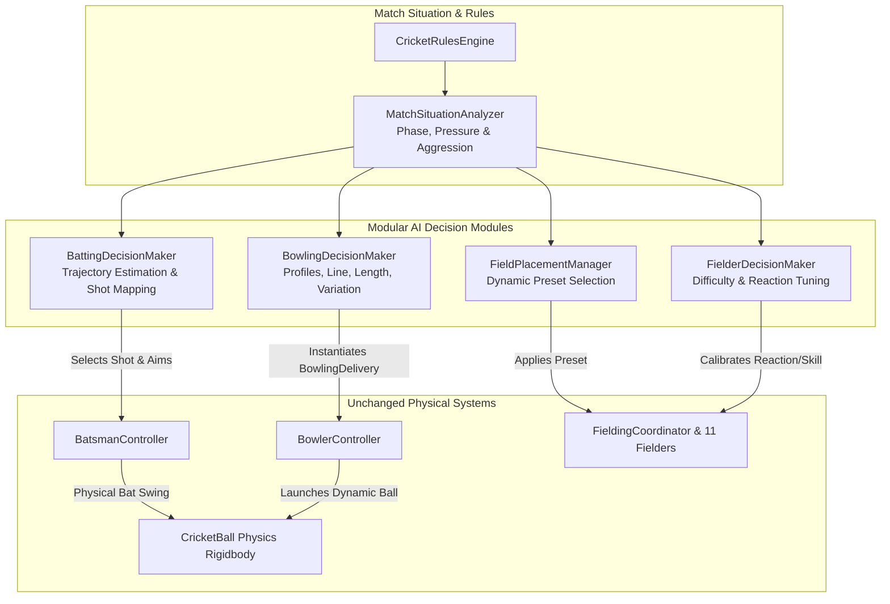

# Cricket Legends — Phase 7: Bowling AI & Fielding Tactics Specification

## 1. Modular AI Architecture

Phase 7 introduces autonomous, computer-controlled opponents for **Cricket Legends**. The system strictly maintains the architectural boundary that **AI decision modules are decoupled from physical simulation, collision detection, and scoring rules**. AI components make tactical decisions by generating standard input commands or ScriptableObject configurations; they **never teleport the ball, modify the score directly, or force artificial dismissals**.

---

## 2. Component Directory

| Component | Path | Responsibility |
|---|---|---|
| [`MatchSituationAnalyzer.cs`](file:///c:/Users/Shiven/Documents/Games/Cricket%20game/Assets/_Game/Scripts/AI/MatchSituationAnalyzer.cs) | `Assets/_Game/Scripts/AI/` | Analyzes match context: Match phase (`Powerplay`, `MiddleOvers`, `DeathOvers`), pressure index (0.0 to 1.0), recommended batting/bowling aggression, and fielding preset recommendations. |
| [`BowlingDecisionMaker.cs`](file:///c:/Users/Shiven/Documents/Games/Cricket%20game/Assets/_Game/Scripts/AI/BowlingDecisionMaker.cs) | `Assets/_Game/Scripts/AI/` | Selects delivery line, length, pace, swing, and spin across 4 profiles (`FastBowler`, `SwingBowler`, `SpinBowler`, `DefensiveBowler`). Adapts to previous outcomes, batter tendencies, and difficulty. |
| [`BattingDecisionMaker.cs`](file:///c:/Users/Shiven/Documents/Games/Cricket%20game/Assets/_Game/Scripts/AI/BattingDecisionMaker.cs) | `Assets/_Game/Scripts/AI/` | Computer-controlled batsman when player bowls. Estimates delivery line/length, selects appropriate strokes from 8 canonical shots, adjusts aggression, and introduces realistic human-like mistiming mistakes. |
| [`FieldPlacementManager.cs`](file:///c:/Users/Shiven/Documents/Games/Cricket%20game/Assets/_Game/Scripts/AI/FieldPlacementManager.cs) | `Assets/_Game/Scripts/AI/` | Dynamically shifts field presets (`Attacking`, `Balanced`, `Defensive`, `BoundaryProtection`) between deliveries based on batter dominance, match phase, and pressure. |
| [`FielderDecisionMaker.cs`](file:///c:/Users/Shiven/Documents/Games/Cricket%20game/Assets/_Game/Scripts/AI/FielderDecisionMaker.cs) | `Assets/_Game/Scripts/AI/` | Calibrates documented difficulty settings across all 11 fielders (reaction delay, sprint velocity, and catch skill). |

---

## 3. Bowling Profiles & Tactical Decision-Making

### 3.1 Profile Archetypes
1. **`FastBowler`**:
   - Speeds: 138–150 km/h.
   - Lengths: Good length, short deliveries, bouncers, and yorkers at the death.
   - Aim: Off stump and middle stump channels with light seam drift.
2. **`SwingBowler`**:
   - Speeds: 126–137 km/h.
   - Lengths: Full and good length (driveable lengths).
   - Aerodynamics: Lateral aerodynamic swing acceleration ($-4.5$ to $+3.8\text{ m/s}^2$) targeting the fourth-stump corridor to induce edges.
3. **`SpinBowler`**:
   - Speeds: 84–98 km/h.
   - Flight & Turn: Sharp angular spin deviation ($-3.2$ to $+2.8\text{ m/s}$) off pitch contact.
   - Aim: Flighted full deliveries and deceptive good length.
4. **`DefensiveBowler`**:
   - Speeds: 116–128 km/h.
   - Lengths: Back of a length.
   - Aim: Wide fifth-stump line ($-0.32\text{m}$) denying hitting arcs to force dot balls.

### 3.2 Tactical Adaptation
- **Disrupting Rhythm**: If the batter scored a boundary on the previous delivery, the AI immediately switches length (e.g. from full to surprise bouncer, or to a toe-crushing yorker).
- **Countering Tendencies**: If the batter repeatedly executes Pull or Cut shots, the AI pitches fuller outside off. If the batter repeatedly drives, the AI pulls the length back.
- **Death Overs**: Prioritizes yorkers on stumps and wide yorkers.

---

## 4. Batting AI Trajectory & Shot Mapping

When facing user bowling, `BattingDecisionMaker` evaluates incoming trajectory and maps to the 8 canonical shots:

| Incoming Trajectory | Primary AI Shot | Aim Vector | Tactical Rationale |
|---|---|---|---|
| **Yorker on Stumps** | `ForwardDefense` | `(0, 0)` | Dig out yorker and protect stumps. |
| **Full outside off** | `CoverDrive` | `(-0.3, 0)` | Drive through the covers with the turn/line. |
| **Full on middle/leg** | `StraightDrive` / `OnDrive` | `(+0.2, 0)` | Punch down the ground or through mid-wicket. |
| **Short / Bouncer on body** | `Pull` | `(+0.5, 0)` | Horizontal cross-bat pull behind square. |
| **Short outside off** | `Cut` | `(-0.6, 0)` | Slash square through point and gully. |
| **Good length on off** | `ForwardDefense` / `BackFootDefense` | `(0, 0)` | Respect good length corridor. |
| **Death overs / High RRR** | `LoftedAttack` | `(0, 0)` | Clear the infield for boundary maximums. |

---

## 5. Documented Difficulty Settings

Difficulty scales strictly via documented AI parameters — **never by modifying physics restitution, collision math, or rules engine scores**:

| Parameter | Easy | Medium | Hard |
|---|---|---|---|
| **Bowler Pitch Spread** | $\pm 0.65\text{m}$ (wide spread) | $\pm 0.28\text{m}$ (standard) | $\pm 0.10\text{m}$ (laser accuracy) |
| **Bowler Pace Multiplier** | $0.90\times$ (slower) | $1.00\times$ (nominal) | $1.04\times$ (elite pace) |
| **Batter Reaction Delay** | $0.35\text{s}$ (delayed downswing) | $0.22\text{s}$ (standard) | $0.12\text{s}$ (elite reflex) |
| **Batter Mistake Probability** | $25\%$ (frequent edges) | $10\%$ (occasional error) | $3\%$ (elite discipline) |
| **Fielder Reaction Delay** | $0.45\text{s}$ | $0.25\text{s}$ | $0.15\text{s}$ |
| **Fielder Catch Skill** | $0.75$ (fumbles/drops) | $0.88$ (standard) | $0.96$ (elite hands) |
| **Field Tactical Shift** | Slower to respond to boundaries | Changes on 2 boundaries | Shifts on 1st boundary or pressure |
