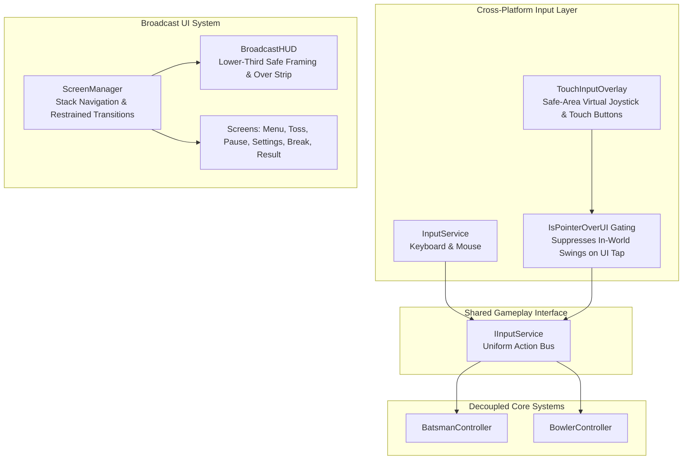

# Cricket Legends — Phase 8: Broadcast UI & Cross-Platform Controls Specification

## 1. Unified Cross-Platform Architecture

Phase 8 elevates **Cricket Legends** to a professional television broadcast aesthetic while maintaining **one shared gameplay codebase** across PC (keyboard/mouse) and Mobile (touchscreen on Android & iOS).

---

## 2. Component Directory

| Component | Path | Responsibility |
|---|---|---|
| [`IInputService.cs`](file:///c:/Users/Shiven/Documents/Games/Cricket%20game/Assets/_Game/Scripts/Input/IInputService.cs) | `Assets/_Game/Scripts/Input/` | Uniform cross-platform input abstraction. Exposes batting strokes, bowling line/length, running between wickets, camera cycling, and pause events. |
| [`InputService.cs`](file:///c:/Users/Shiven/Documents/Games/Cricket%20game/Assets/_Game/Scripts/Input/InputService.cs) | `Assets/_Game/Scripts/Input/` | PC keyboard and mouse implementation. Supports runtime key rebinding. |
| [`TouchInputOverlay.cs`](file:///c:/Users/Shiven/Documents/Games/Cricket%20game/Assets/_Game/Scripts/Input/TouchInputOverlay.cs) | `Assets/_Game/Scripts/Input/` | Mobile on-screen touch controls. Features safe-area notch compensation, virtual directional joystick, and pointer gating (`IsPointerOverUI`). |
| [`ScreenManager.cs`](file:///c:/Users/Shiven/Documents/Games/Cricket%20game/Assets/_Game/Scripts/UI/ScreenManager.cs) | `Assets/_Game/Scripts/UI/` | Central UI manager with stack-based screen navigation (`SwitchToScreen`, `OpenOverlay`, `GoBack`). Enforces fast transitions ($\le 0.2\text{s}$). |
| [`BroadcastHUD.cs`](file:///c:/Users/Shiven/Documents/Games/Cricket%20game/Assets/_Game/Scripts/UI/Screens/BroadcastHUD.cs) | `Assets/_Game/Scripts/UI/Screens/` | Television lower-third HUD. Displays score, overs, CRR, RRR, target, striker/non-striker cards, bowler figures, over ball strip, and event banners. Framed to never obstruct pitch action. |
| [`ScreenImplementations.cs`](file:///c:/Users/Shiven/Documents/Games/Cricket%20game/Assets/_Game/Scripts/UI/Screens/ScreenImplementations.cs) | `Assets/_Game/Scripts/UI/Screens/` | Complete suite of screens: `MainMenuScreen`, `TeamSelectionScreen`, `MatchConfigurationScreen`, `TossScreen`, `PauseMenuScreen`, `InningsBreakScreen`, `MatchResultScreen`, `SettingsScreen`, and `HowToPlayScreen`. |

---

## 3. Broadcast Design Language & Framing

### 3.1 Visual Language & Color Palette
- **Primary Navy**: `#0A1128` (deep broadcast navy backdrop).
- **Secondary White**: `#F4F7FB` (crisp ice-white readable typography).
- **Accent Gold**: `#F7B801` (cricket gold highlight for boundaries, milestones, and active striker).
- **Turf Emerald**: `#107E57` (positive indicators, run rate surplus).
- **Wicket Crimson**: `#D62828` (wickets and warning banners).

### 3.2 Pitch Action Visibility
- Lower-third HUD is anchored along bottom screen margins ($y \le 18\%$ of viewport).
- Pitch corridor, bowler release point ($Z = -9.8\text{m}$, $Y = 1.95\text{m}$), and batsman popping crease ($Z = +8.84\text{m}$) remain **100% unobstructed**.
- Long names are automatically truncated with ellipses (`FormatPlayerName`) to prevent UI overflow on compact mobile viewports.

---

## 4. Cross-Platform Input Controls

### 4.1 PC Controls (Keyboard & Mouse)
- <kbd>Space</kbd> / <kbd>Enter</kbd>: Execute Shot / Release delivery.
- <kbd>A</kbd> / <kbd>D</kbd> or <kbd>←</kbd> / <kbd>→</kbd>: Directional shot aim.
- <kbd>W</kbd>: Quick attacking shot toggle (Straight Drive / Lofted Attack).
- <kbd>S</kbd>: Quick defensive shot toggle (Forward / Back Foot Defense).
- <kbd>1</kbd>–<kbd>8</kbd>: Direct shot preset selection.
- <kbd>R</kbd>: Call run between wickets.
- <kbd>X</kbd>: Cancel run.
- <kbd>C</kbd>: Cycle broadcast camera views.
- <kbd>Escape</kbd>: Pause menu.

### 4.2 Mobile Touch Controls
- **Virtual Directional Joystick**: Touch and drag to aim shot azimuth and placement.
- **`SWING` Button**: Primary stroke execution.
- **`ATTACK` / `DEFEND` Buttons**: Quick style toggles.
- **`LOFT` Button**: Maximum aerial boundary attack.
- **`RUN` & `CANCEL` Buttons**: Running between wickets.
- **`PAUSE` Button**: Top-right safe-area anchored pause.
- **Touch Gating**: `EventSystem.current.IsPointerOverGameObject()` suppresses in-world inputs when touching HUD buttons, preventing accidental swings or releases.

---

## 5. Pause State Integrity

- When `PauseMenuScreen.Open()` is called:
  - `Time.timeScale` is frozen to `0f`.
  - Delivery timers and ball physics are suspended.
  - Match scores and delivery resolution state are **strictly preserved with zero mutation**.
- When resumed, `Time.timeScale` is restored to `1.0f`.
