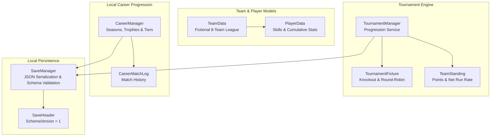

# Cricket Legends — Phase 9: Tournament & Career System Specification

## 1. System Architecture

Phase 9 introduces local offline **Tournament Modes** and a multi-season **Career Mode** to **Cricket Legends** without breaking exhibition match configurations.

---

## 2. Component Directory

| Component | Path | Responsibility |
|---|---|---|
| [`PlayerData.cs`](file:///c:/Users/Shiven/Documents/Games/Cricket%20game/Assets/_Game/Scripts/Gameplay/PlayerData.cs) | `Assets/_Game/Scripts/Gameplay/` | Fictional player attributes (batting/bowling skill 50–99, bowling profile archetype) and cumulative career stats (runs, wickets, fours, sixes, highest score). |
| [`TeamData.cs`](file:///c:/Users/Shiven/Documents/Games/Cricket%20game/Assets/_Game/Scripts/Gameplay/TeamData.cs) | `Assets/_Game/Scripts/Gameplay/` | Fictional team identity (name, shortcode, primary/secondary colors, emblem name, and 11-player squad roster). Generates an 8-team fictional league database without real-world likenesses or protected trademarks. |
| [`TournamentData.cs`](file:///c:/Users/Shiven/Documents/Games/Cricket%20game/Assets/_Game/Scripts/Gameplay/TournamentData.cs) | `Assets/_Game/Scripts/Gameplay/` | Contains `TournamentFixture` and `TeamStanding` with official Net Run Rate (NRR) computation and standard multi-tier sorting comparisons. |
| [`TournamentManager.cs`](file:///c:/Users/Shiven/Documents/Games/Cricket%20game/Assets/_Game/Scripts/Gameplay/TournamentManager.cs) | `Assets/_Game/Scripts/Gameplay/` | Central progression service for Knockout (bracket progression) and Round-Robin (league stage + Grand Final) tournaments. Enforces strict single-result recording and champion crowning. |
| [`CareerManager.cs`](file:///c:/Users/Shiven/Documents/Games/Cricket%20game/Assets/_Game/Scripts/Gameplay/CareerManager.cs) | `Assets/_Game/Scripts/Gameplay/` | Offline career progression: Tracks manager profile, matches played, win rate, trophy cabinet, tournament tier unlocks (Tier 1 $\rightarrow$ Tier 2 $\rightarrow$ Tier 3), and match histories. |
| [`SaveManager.cs`](file:///c:/Users/Shiven/Documents/Games/Cricket%20game/Assets/_Game/Scripts/SaveSystem/SaveManager.cs) | `Assets/_Game/Scripts/SaveSystem/` | Local JSON persistence with schema versioning (`SchemaVersion = 1`), integrity validation, in-memory test fallback, and graceful recovery from missing or corrupted saves. |

---

## 3. Fictional Teams Database

The database features 8 balanced fictional clubs:
1. **Mumbai Blasters (`MBL`)**: Navy (`#0A2661`) & Gold (`#F2BF1A`) | Fast bowling focus.
2. **London Monarchs (`LMO`)**: Royal Blue (`#1E3B8A`) & Crimson (`#D91A33`) | Swing bowling focus.
3. **Melbourne Strikers (`MST`)**: Emerald (`#0F7340`) & Charcoal (`#333333`) | Fast bowling focus.
4. **Cape Town Titans (`CPT`)**: Teal (`#14808C`) & Tangerine (`#F2731A`) | Defensive bowling focus.
5. **Sydney Phantoms (`SYP`)**: Violet (`#8C1A8C`) & Cyan (`#1AD9D9`) | Spin bowling focus.
6. **Kolkata Royals (`KRO`)**: Purple (`#4D1F73`) & Amber (`#E6CC33`) | Spin bowling focus.
7. **Karachi Falcons (`KFA`)**: Forest Green (`#0D5926`) & Silver (`#CCCCCC`) | Fast bowling focus.
8. **Auckland Waves (`AKW`)**: Sky Blue (`#268CD9`) & White (`#F2F2F2`) | Swing bowling focus.

---

## 4. Tournament Formats & Net Run Rate

### 4.1 Formats
- **Knockout**: Bracket progression (Quarter-Finals $\rightarrow$ Semi-Finals $\rightarrow$ Final).
- **Round-Robin League**: Pairwise round-robin schedule ($N \times (N-1) / 2$ matches). Top 2 teams in the standings automatically qualify for the Grand Final.

### 4.2 Official Net Run Rate (NRR) Formula
$$NRR = \left(\frac{\text{Total Runs Scored}}{\text{Total Overs Faced}}\right) - \left(\frac{\text{Total Runs Conceded}}{\text{Total Overs Bowled}}\right)$$
- Standings are ranked by:
  1. Points (2 for win, 1 for tie/NR, 0 for loss).
  2. Net Run Rate (descending).
  3. Total Wins (descending).
  4. Alphabetical name.

---

## 5. Local Persistence & Schema Validation

- **Schema Version**: `SchemaVersion = 1`.
- **Validation**: Inspects schema version, non-null standings, and fixture collections.
- **Corrupted / Missing Save Recovery**:
  - Missing file $\rightarrow$ logs warning and creates fresh tournament/career state.
  - Corrupted JSON syntax $\rightarrow$ catches parse exceptions without crashing.
  - Outdated schema version $\rightarrow$ flags mismatch and falls back safely.
