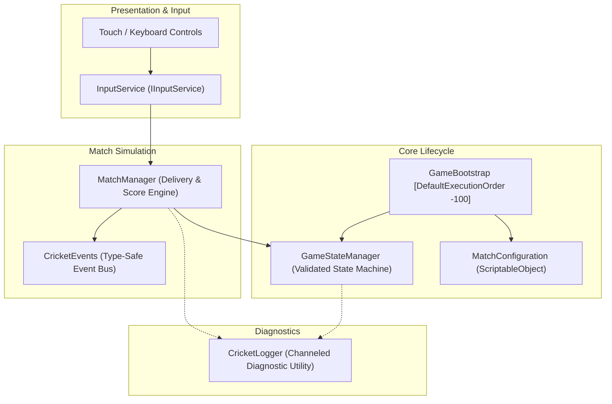
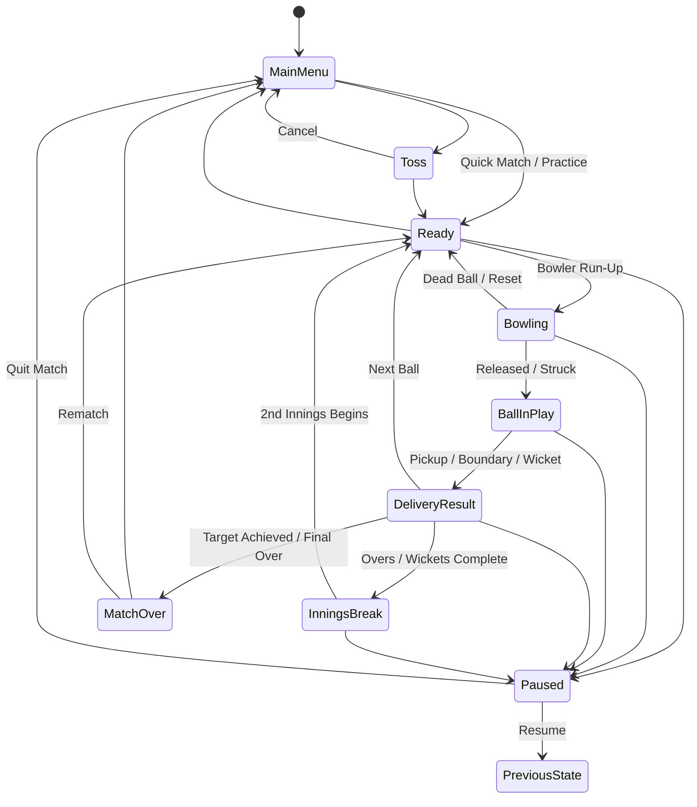

# Cricket Legends — Technical Architecture (Phase 1)

## 1. System Overview

Cricket Legends is architected as a modular, event-driven professional cricket simulation built on **Unity 6 LTS** using the **Universal Render Pipeline (URP)**. The runtime architecture decouples hardware input, match state orchestration, delivery physics, and scoring rules.



---

## 2. Finite State Machine (GameStateManager)

The game simulation strictly enforces a directed state transition graph. Invalid transitions (e.g. attempting to jump from `MainMenu` directly to `BallInPlay`) are rejected with diagnostic warnings.



### State Definitions
| State | Description | Invariants |
|---|---|---|
| `MainMenu` | Start screen & settings hub | No match entities spawned. |
| `Toss` | Coin toss ceremony & decision | Establishes batting/bowling sides. |
| `Ready` | Fielders set, batter waiting at crease | Delivery ID prepared; waiting for bowler trigger. |
| `Bowling` | Bowler in active run-up/arm rotation | **Exactly 1 active delivery allowed.** |
| `BallInPlay` | Ball moving, timing window, fielder chase | Physics active; hit collisions evaluated. |
| `DeliveryResult`| Outcome recorded (runs, wicket, extra) | Delivery completed flag released. |
| `InningsBreak` | 1st innings complete; target established | Score reset for chasing team; sides switched. |
| `MatchOver` | Final scorecard & victory screen | Match terminated; input disabled. |
| `Paused` | Pause menu overlay active | Stores previous unpaused state for resume. |

---

## 3. Core Subsystems

### 3.1 GameBootstrap
- Executes at `[DefaultExecutionOrder(-100)]`.
- Targets 60 FPS across desktop and mobile devices.
- Validates serialized references to `GameStateManager`, `MatchManager`, `InputService`, and `MatchConfiguration`.
- Provides automatic runtime fallback instances if components are unassigned, preventing null-reference crashes.

### 3.2 MatchManager & Delivery Invariant
- **Single Active Delivery Invariant**:
  ```csharp
  if (_isDeliveryActive)
  {
      CricketLogger.LogWarning(LogChannel.Gameplay,
          $"DELIVERY REJECTED: Delivery #{_activeDeliveryId} is currently active.");
      return false;
  }
  ```
- Manages legal deliveries per over (6 legal balls), dot balls, extras, wickets, maidens, and innings completion.
- Dispatches type-safe events via `CricketEvents`.

### 3.3 MatchConfiguration (ScriptableObject)
- Configurable in the Unity Inspector without recompilation.
- Parameters:
  - `MatchFormat`: SuperOver (1), TwoOvers (2), FiveOvers (5), T20 (20), ODI (50), Custom.
  - `DifficultyLevel`: Easy, Medium, Hard.
  - `StadiumEnvironment`: DaySunny, DayOvercast, NightFloodlights.
  - `BallColor`: WhiteLeather, RedLeather, PinkLeather.
  - `Team Names` & Batting order.

### 3.4 InputService (IInputService)
- Decouples hardware input devices from gameplay.
- Cross-platform support for:
  - Windows PC (Keyboard & Mouse, Gamepad).
  - Android & iOS (Touch screen UI, on-screen buttons, analog joysticks).
- Dispatches distinct batting actions:
  - `Defensive Block`, `Straight Drive`, `Cover Drive`, `Pull Shot`, `Cut Shot`, `Lofted Attack`.
